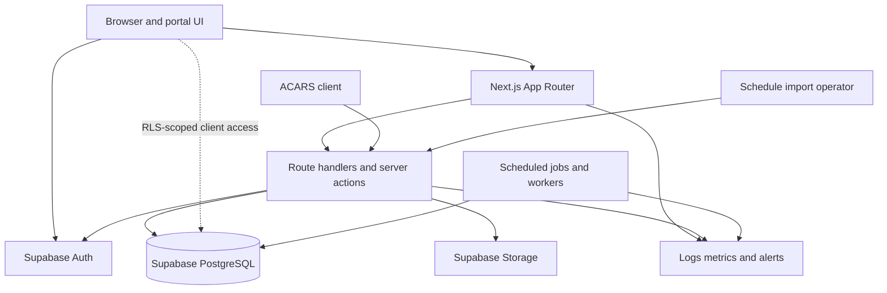
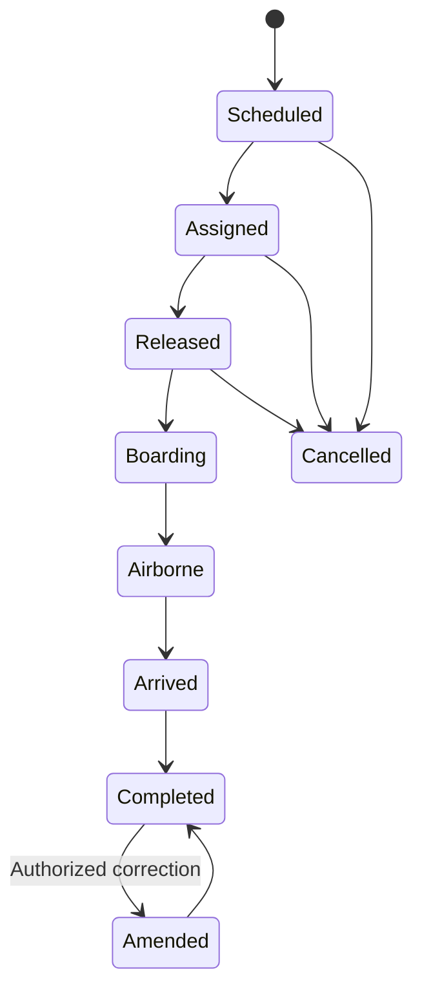

# Architecture overview

## Scope and current state

JVA is a Next.js 16 App Router application intended to use Supabase for PostgreSQL, Auth, Storage, and Realtime. Today, `src/app/` contains public pages and catch-all portal shells; the database and integration layers remain to be implemented.

The architecture below is the production target. It favors server-side data access, PostgreSQL-enforced authorization, and asynchronous ingestion for high-volume or privileged workflows.

## Runtime responsibilities

### Next.js application

- `src/app/` owns routing, layouts, React Server Components, loading/error boundaries, and route handlers.
- Server Components perform initial reads where possible; interactive islands are Client Components.
- Mutations use Server Actions for browser form workflows or Route Handlers for stable integration APIs.
- Supabase browser clients use only the publishable key. Server clients propagate the authenticated user's cookies so RLS remains authoritative.
- A service-role client is permitted only in server-only modules for narrowly scoped administration and background jobs. Never import it into a Client Component.
- In Next.js 16, dynamic request APIs and route `params` are asynchronous. Follow the installed framework documentation when adding code.

### Supabase

- **Auth:** email/password or approved identity provider; MFA required for privileged roles in production.
- **PostgreSQL:** system of record, constraints, business invariants, role grants, and RLS.
- **Storage:** schedule source files, generated exports, and optional flight attachments. Buckets are private unless explicitly documented as public.
- **Realtime:** optional operational board updates. Subscriptions do not bypass RLS.
- **Edge Functions/worker:** optional long-running imports, notifications, and aggregation. Prefer database jobs or a dedicated queue for retryable work.

## Trust boundaries

1. The browser is untrusted. Hidden controls and client validation improve UX only.
2. Next.js server code is trusted only to the degree of its active credential. User-scoped requests retain RLS; service-role requests bypass it.
3. ACARS devices are untrusted integration clients. Authenticate, rate-limit, validate, and make writes idempotent.
4. Imported files are untrusted. Store privately, scan if supported, parse with limits, and stage before publication.
5. PostgreSQL is the final authorization and integrity boundary. Enforce tenant/community scope, state transitions, and uniqueness there.

## Product modules

| Module | Routes represented today | Target responsibility |
|---|---|---|
| Public information | `/`, `/about`, `/fleet`, `/network`, `/statistics`, `/legal` | Sanitized network, fleet, movement, and aggregate statistics |
| Recruitment and access | `/apply`, `/login` | Applications, Auth, onboarding, account recovery |
| Command | `/command/[[...section]]` | Operations, schedules, routes, missions, fleet, maintenance, personnel, reports, audit, settings |
| Dispatch | `/dispatch/[[...section]]` | Flight release, aircraft/crew assignment, load and operational checks |
| Live operations | `/ops/[[...section]]` | Movement board, map, statuses, irregular operations |
| Crew | `/crew/[[...section]]` | Pilot dashboard, bids/assignments, qualifications, training, logbook |
| Reporting | Command reports/statistics | Reliability, utilization, completion, training, and audit views |
| Integrations | Target `/api/v1/acars/*`, import jobs | ACARS telemetry, PIREPs, schedule ingestion, notifications |

Catch-all pages are navigation scaffolds, not module-level authorization boundaries. Implement protected route groups and server-side authorization before exposing real data.

## Target data domains

Use UUID primary keys, `created_at`/`updated_at` timestamps, explicit foreign keys, and constrained status types. Suggested domain ownership:

- **Identity:** `profiles`, `memberships`, `roles`, `membership_roles`, `applications`.
- **Network:** `stations`, `routes`, `route_legs`.
- **Fleet:** `aircraft_types`, `aircraft`, `maintenance_events`, `aircraft_status_history`.
- **Crew:** `qualifications`, `member_qualifications`, `training_records`, `currency_events`.
- **Scheduling:** `schedule_versions`, `schedule_services`, `schedule_legs`, `import_jobs`, `import_rows`.
- **Operations:** `flights`, `flight_assignments`, `dispatch_releases`, `flight_events`, `position_reports`, `pireps`.
- **Missions:** `missions`, `mission_flights`; details are restricted by role and classification.
- **Governance:** `audit_events`, `system_settings`, `outbox_events`.

Prefer normalized write models and purpose-built views/materialized views for dashboards. Public views must expose only allow-listed columns and sanitized station labels.

## Core lifecycle

State transitions should be implemented through transactional database functions or server-side domain services, not arbitrary table updates. A completed flight updates aircraft location/utilization, crew records, schedule completion, and audit history in one transaction or a reliable outbox workflow.

## Availability and consistency

- The primary region should be close to the majority of users and the Next.js deployment.
- Reads shown on live boards may be eventually consistent; release, assignment, qualification, and completion writes must be strongly consistent.
- Use idempotency keys for ACARS events, imports, and retryable mutations.
- Do not make essential workflows depend solely on Realtime delivery. Re-fetch canonical state after reconnect.
- Define initial targets before launch: 99.9% web/API availability, RPO ≤ 24 hours, RTO ≤ 4 hours. Tighten these only after backup automation and restore drills prove them.

## Observability

Every server request/job should carry a correlation ID. Record structured events for authentication failures, authorization denials, import outcomes, ACARS rejects, privileged changes, and background retries. Never log passwords, tokens, service keys, raw cookies, or sensitive mission notes.
