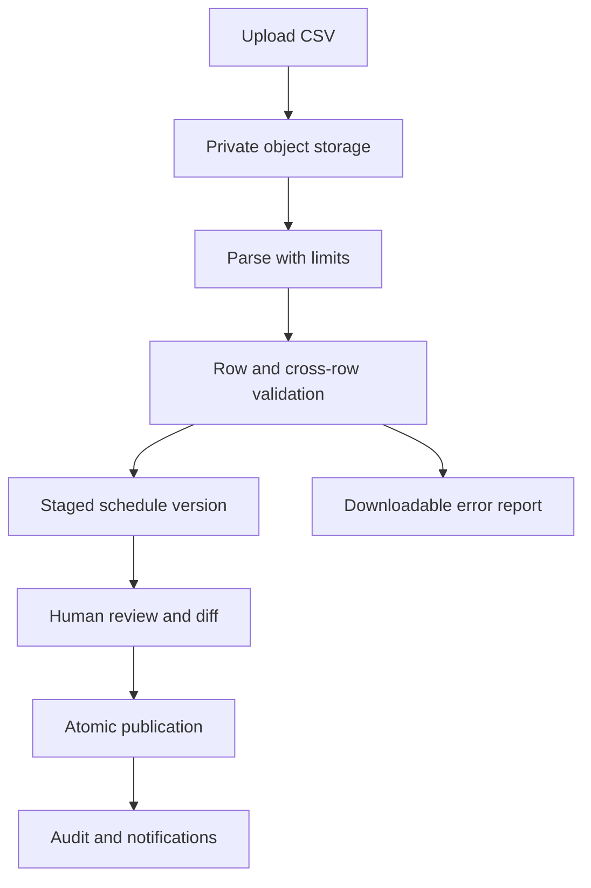

# Schedule importer guide

## Status and purpose

The schedule importer is a target workflow and is not currently implemented. It converts an operator-supplied CSV into a staged, validated, versioned schedule. Importing never changes the active schedule directly; publication is a separate audited action.

## Workflow



Recommended states: `uploaded`, `validating`, `invalid`, `ready`, `publishing`, `published`, `failed`, `cancelled`. A worker claims jobs using row locking, records attempts, and can safely resume.

## CSV contract

- UTF-8 with a header row; optional UTF-8 BOM accepted.
- Comma delimiter and RFC 4180 quoting.
- Maximum file size: 10 MiB; maximum rows: 50,000 (lower limits may be configured).
- Blank lines ignored. Duplicate headers, unknown headers, and formulas in exported reports are rejected/escaped.
- Times use 24-hour `HH:mm`; service dates use ISO `YYYY-MM-DD`.
- `days_of_week` uses comma-free digits `1`–`7` (Monday–Sunday), e.g. `12345`.

Required initial columns:

| Column | Required | Example | Rules |
|---|---:|---|---|
| `service_code` | yes | `JVA-WD-001` | Stable within schedule version |
| `flight_number` | yes | `11` | 1–4 numeric characters |
| `callsign` | yes | `JANET11` | Uppercase approved prefix/format |
| `origin` | yes | `LAS` | Existing active station code |
| `destination` | yes | `STN3` | Existing active station; differs from origin |
| `departure_local` | yes | `03:40` | Valid local wall time |
| `arrival_local` | yes | `04:25` | Valid local wall time |
| `origin_timezone` | yes | `America/Los_Angeles` | Valid IANA time zone matching station |
| `days_of_week` | yes | `12345` | Unique digits 1–7 |
| `effective_from` | yes | `2026-08-03` | Inclusive date |
| `effective_to` | no | `2026-12-31` | Inclusive; not before start |
| `aircraft_type` | yes | `B737` | Existing schedulable type code |
| `route_code` | yes | `LAS-STN3-A` | Existing active route or approved creation workflow |
| `block_minutes` | yes | `45` | Positive and within configured maximum |
| `operation_type` | yes | `commuter` | Controlled value |
| `notes` | no | `Weekday rotation` | Plain text; length-limited; never secret |

Example:

```csv
service_code,flight_number,callsign,origin,destination,departure_local,arrival_local,origin_timezone,days_of_week,effective_from,effective_to,aircraft_type,route_code,block_minutes,operation_type,notes
JVA-WD-001,11,JANET11,LAS,STN3,03:40,04:25,America/Los_Angeles,12345,2026-08-03,2026-12-31,B737,LAS-STN3-A,45,commuter,Weekday rotation
```

If destination local time or time zone is later required, add versioned columns and preserve backward compatibility. Do not infer operational UTC timestamps permanently at import; derive occurrences using the station time zone and service date so daylight-saving rules are explicit.

## Validation

### Row-level

- required fields, type, length, enum, and format checks;
- normalized uppercase codes without silently changing semantic content;
- station, route, and aircraft-type references exist and are active;
- effective range and block time are valid;
- notes are safe plain text and within limits.

### Cross-row and database

- unique service code/version combination;
- duplicate flight occurrence detection;
- no overlapping service definitions with conflicting identity;
- feasible arrival day offset and block time;
- aircraft type compatible with route/stations;
- route direction matches origin/destination;
- no publication conflict with locked or completed operational flights.

The error report should include row number, field, stable error code, safe message, and severity. Do not include SQL or stack traces.

## Staging and publication

1. Authenticated dispatcher or operations manager uploads a file using a short-lived signed request.
2. Server records SHA-256 checksum, original filename, size, actor, and idempotency key; object remains private.
3. Worker parses into bounded staging tables in a transaction per batch.
4. Operator reviews counts, warnings, errors, and a diff from the active version.
5. An operations manager publishes. Publication atomically marks the new version active and the previous version superseded.
6. Future flight instances are generated idempotently for a bounded horizon. Existing released/active/completed flights are not rewritten.
7. Audit records link the source checksum, import job, schedule version, publisher, and result.

Re-uploading an identical checksum should return the previous job unless the operator explicitly requests a revalidation under a newer importer version.

## Failure and rollback

- Parsing/validation failures leave the active schedule untouched.
- Worker retries must not duplicate staged rows or generated flights.
- A failed publication transaction rolls back entirely.
- Rollback means publishing a new version based on a prior version, not deleting history.
- Source files and reports follow configured retention; schedule versions and publication audit records remain immutable.

## Security

Apply strict MIME/size limits, protect against CSV formula injection in downloadable reports, avoid loading the full file into memory, and never execute spreadsheet macros. Imported notes cannot contain secrets or real sensitive operational information. Only authorized users can upload; only operations managers can publish.
